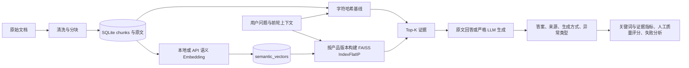

# RAG 完整链路补充设计（2026-11-03）

## 版本与目标

本次更新保留已验证的业务界面、清洗、FAQ、产品版本隔离、反馈和人工兜底，新增可切换语义检索、FAISS 索引、严格生成模式、45 题实验和质量评阅流程。早期文档中“无语义 Embedding／无向量索引”仅描述字符基线；本节是新增能力的当前说明。没有实现模型微调或 GraphRAG；课程允许使用预训练模型/API，GraphRAG 为可选探索。

## 模块与数据流

app/semantic.py 封装本地 SentenceTransformer 与兼容 /embeddings 的 API。app/core.py 根据 RAG_RETRIEVER 选择字符或语义检索，根据 RAG_ANSWER_MODE 决定 FAQ 快捷回答、抽取式回答或严格模型生成。reindex.py 提供管理员命令行建索引。benchmark.py 与 app/experiments.py 在独立临时库中运行固定实验；review_results.py 汇总带证据的人工评分。scripts/plot_results.py 从实际 JSON 生成 PNG/PDF，scripts/build_deliverables.py 生成可编辑 Word、PPT 和不含运行数据库的代码包。

## 语义向量与 FAISS

本地 provider 使用 SentenceTransformer，默认是多语言 paraphrase-multilingual-MiniLM-L12-v2；API provider 使用 EMBEDDING_BASE_URL、EMBEDDING_API_KEY、EMBEDDING_MODEL。模型输入为清洗后、保留标题的片段，查询使用完整问题或追问改写。API 响应按 index 重排并核验数量，向量转为 float32，拒绝零向量、非有限值及错误维度，再做 L2 归一化。归一化向量内积等同余弦相似度，FAISS 使用 IndexFlatIP 搜索。

新增 semantic_vectors 表：chunk_id、identity、content_hash、vector、dimension，主键为 (chunk_id, identity)，chunk_id 外键级联删除。identity 是 provider、模型名和 API 地址的摘要，content_hash 是片段内容摘要；不记录密钥。字符基线 chunks.vector 和 FAQ 哈希向量保持独立。换模型或服务地址不会错误复用旧模型向量；若同一模型名背后的版本或维度发生变化，应修改模型标识，不能把不同空间的向量混用。

索引以 32 个片段为一批，模型推理在写事务之外；完成后只保存仍存在的片段，避免文档删除与慢推理之间的竞态。入库先保存原文与基线向量；语义向量由命令、页面按钮或首次语义问答补建，所以模型服务中断不会阻止原文保存。问答在会话写事务开始前完成语义补建，避免嵌套写连接互锁。向量化是幂等的，重复执行只处理缺失或变化片段。

每次语义检索先按 product_id、version、identity 筛选，再创建该范围的 FAISS 索引，避免全库 Top-K 后过滤导致漏召回。语义向量持久化在 SQLite；FAISS 索引在进程内重建，不单独保存 .faiss 文件。IndexFlatIP 是精确全量索引，时间复杂度仍与范围内片段数和维度成正比；当前设计用于小语料演示，没有声称具备 ANN 或大规模在线性能。数据增长后可引入索引缓存、HNSW 或独立向量服务。

本地 torch 和 FAISS 默认各限制为 1 个 CPU 线程，避免课堂机器上多套 OpenMP 线程池竞争；可使用 RAG_EMBEDDING_THREADS 调整。模型缓存由 HF_HOME 指定，首次下载需网络；断网前必须预先缓存模型。optional 依赖没有加入基础启动依赖，原有纯离线字符模式仍可使用。新增语义依赖在当前 macOS 环境验证，不代表已通过全部 Windows/Python 版本矩阵。

## 回答编排与可观测性

RAG_ANSWER_MODE=auto 保留 FAQ 优先，未命中时尝试模型，配置不足或模型异常时回退原文。extractive 跳过 FAQ 快捷回答与模型生成，使用 Top-1 原文，适合作为检索对比基线。llm 跳过 FAQ 快捷回答，检索满足门槛后必须调用模型；没有模型、超时、空答案等情况返回 no_answer、generation_mode=error 和脱敏异常类型，不把回退结果冒充模型输出。FAQ 冲突、敏感业务与产品选择分支仍保留。

回答新增 retriever、generation_mode、generation_error，生成方式区分 faq、extractive、llm、rule、error。模型按默认或保存的 Prompt 生成，以编号提供最多 3 个证据片段。标准拒答短语被识别为 no_answer。该识别仍属于有限规则，不能替代语义质量评估；模型可能以其他方式拒答，也可能对高相似但不足以作答的证据生成错误答案。本次没有宣称实现在线逐事实验证。

语义默认门槛为 0.35，字符基线为 0.16，可由 RAG_MIN_SCORE 覆盖。这些不是校准后的置信概率。语义相似不能直接证明资料充分，实际实验中的语音转写、价格、考试周安排与邮寄问题仍出现错误接受，已保留为失败案例。未来应在独立开发集标定门槛，并对主体、时间条件、否定和证据充分性进行专项评估。

## 新增接口与界面

GET /api/rag/status 返回检索模式、回答模式、Embedding provider/模型名、可选依赖可用性、当前模型已索引片段数和 LLM 是否配置；不返回密钥或 API 地址。POST /api/rag/reindex 补建语义向量，返回片段数、本次新增数及模型标识，异常返回脱敏服务错误。知识配置页展示状态和补建按钮，聊天来源面板展示回答方式。“已配置”仅代表本机或环境配置完整，不代表远程调用已成功。

现有 GET /api/evaluation 保持 8 题数据库快照回归，避免兼容性变化。45 题完整对比由 CLI 运行，输出到 reports/latest。网页不会悄悄发起真实 LLM 批量实验，操作人员需按评估说明明确运行相应命令。

## 实验、质量与边界

实验语料 6 份、原文 1027 字符，清洗与 FAQ 补片后 31 个检索片段、15 个初始 FAQ。45 个问题包括 36 个可回答、8 个无答案和 1 个转人工问题。语料和题目均是本项目构造的小规模教学数据；没有独立外部测试集。本次通过同一语料和问题比较两种检索后原文回答，不把检索方案差异与 LLM 生成差异混为一谈。

benchmark.json 保存 UTC 运行时间、Python 版本、模型名称、题目与语料 SHA256、分块统计、清洗统计、阈值、逐题证据、答案、生成方式和异常类型。题目关键词指标仅作可复现近似核查；证据 Hit@K 同时要求来源和证据子串。人评表与具体答案快照绑定，防止混用不同实验的分数。人工质量分数在评阅前为 null，并报告评阅覆盖率。

模型 API 端到端实验依赖用户提供的服务与访问凭证；未运行时在结果中列为 skipped。现有结果不含真实 LLM 质量结论。团队需补充人工评分、真实成员分工、每人贡献说明与互评，不可由程序生成虚构个人工作。课堂报告应由团队根据技术材料核对和撰写，外部模型和代码需引用来源。

## 参考资料

- FAISS 官方入门：https://github.com/facebookresearch/faiss/wiki/Getting-started
- Sentence Transformers 文档：https://www.sbert.net/docs/sentence_transformer/usage/usage.html
- 默认模型卡：https://huggingface.co/sentence-transformers/paraphrase-multilingual-MiniLM-L12-v2
- Embedding API 协议参考：https://developers.openai.com/api/reference/resources/embeddings/methods/create

## 免费服务配置扩展

app/llm_config.py 提供 OpenRouter、Groq、Gemini 与自定义兼容服务预设。默认仅预选免费路由，不附共享 Key。网页配置与按服务商隔离的密钥原子写入数据库旁 *.llm.json，优先于环境变量；配置查询不回传密钥。POST /api/llm/test 发固定短句，脱敏处理 401/403/404/429 等错误。严格问答模式保留模型错误提示，不误显示为资料不足。完整接口与操作见 docs/FREE_API_SETUP.md。
